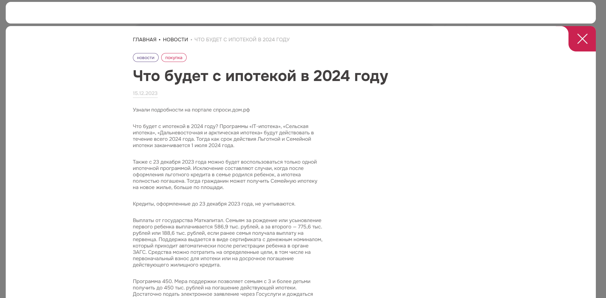

# News Feed

Тестовое задание: лента новостей с детальным просмотром в попапе и отдельными версиями интерфейса для desktop и mobile.

🔗 **Демо:** [sweetp35.github.io/vue-news/](https://sweetp35.github.io/vue-news/)



## Стек

- **Vue 3** (Composition API, `<script setup>`)
- **Vue Router** — вложенные маршруты: новость открывается в попапе по адресу `/news/:id`
- **SCSS** — отдельный файл стилей для каждого компонента, адаптивная вёрстка
- **Fetch API** — загрузка данных с REST API
- **Vite**, **ESLint**, **Oxlint**

## Возможности

- Карточка новости: дата, изображение, заголовок, теги
- Детальная новость в попапе с анимацией открытия и закрытия (`<Transition>`, `<Teleport>`)
- Хлебные крошки с названием текущей новости
- Отдельные компоненты для desktop и mobile, выбор версии по устройству и ширине экрана
- Состояния загрузки и ошибки

## Запуск

```bash
npm install
npm run dev
```
